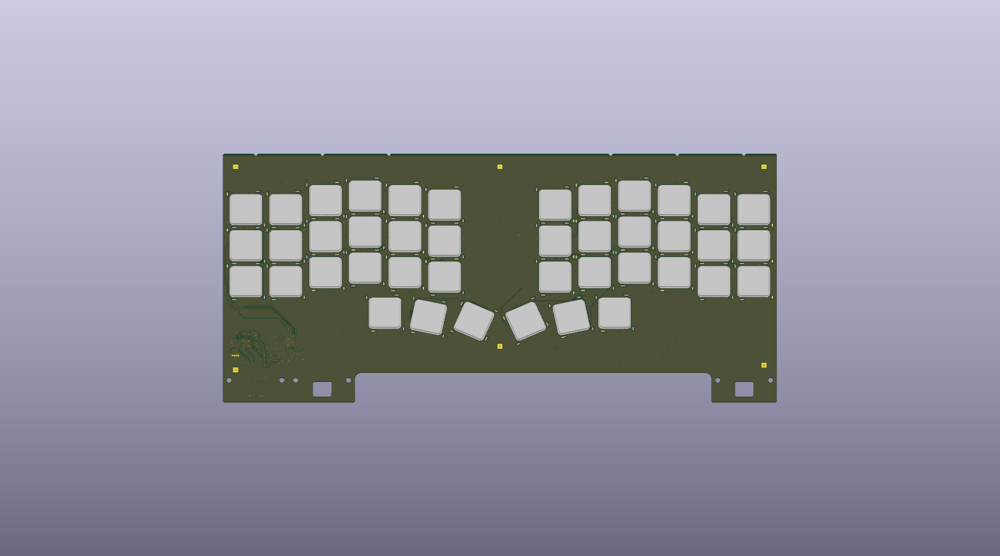
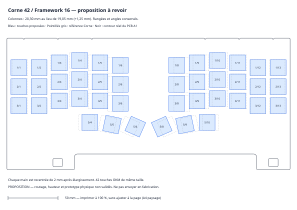

# Corne42 / Framework 16 — design review prototype

**Not released for fabrication, assembly, flashing or installation. No physical prototype has been tested.**

This is an AI-assisted derivative of Axel Voitier's HandyWork and A1 templates,
with 42 One Key Modules in a Corne-inspired layout: 3 × 6 keys plus 3 thumb keys
per hand. It uses OKMs, **not Choc switches**. The Corne Chocolate reference supplies
key positions; the controller and electrical design come from HandyWork.
Horizontal pitch is increased from 19.05 to 20.30 mm to avoid OKM pad/tab collisions;
vertical pitch remains 19.05 mm, with each half shifted inward by 2 mm. This is
not an exact reproduction of every Corne variant or of its keycap dimensions.



KiCad rendering of the actual PCB and embedded OKM models. The aluminium top
plate and laptop chassis are not shown; this is not a photograph or a fit validation.



## Review entry points

- [Main PCB and schematic](PCB/Corne42-PCB.kicad_pro), with project-relative libraries
  in `../Corne42.pretty` and `../Corne42.kicad_sym`.
- [Aluminium plate](AluPlate/Corne42-AluPlate.kicad_pro).
- [Firmware source](Firmware), [matrix/LED mapping](Review/electrical-mapping.json).
- [DRC](Review/drc.json), [ERC](Review/erc.json), [plate DRC](Review/plate-drc.json).
- [Conditional height calculation](Review/height-budget-conditional.json),
  [aperture check](Review/plate-aperture-check.json).
- [BOM](Review/BOM-review-only.csv), [supplier CPL](Review/CPL-review-only.csv),
  [controller underside](Review/controller-assembly-detail.svg), all **review only**.

The existing HandyWork files and shared Framework libraries are unchanged.
The local footprint variants preserve the per-component geometry used in the
reviewed board; they are supplied for library parity, not as new general-purpose
footprints. The corrected OKM footprint from upstream main is the starting point.

## Digital evidence and its limits

KiCad 10.0.7: **zero DRC errors, zero unconnected items, zero schematic/PCB parity
violations and zero ERC errors** in the supplied reports. These are design-rule
and consistency results, not proof of functional hardware.

The 42 DRC warnings report mixed SMD signal pads and plated mechanical slots on
OKMs. The 24 ERC warnings report inherited `C_Small` library differences; the
prior review compared pin geometry and types. The reports retain these warnings.
The main board report has no ignored checks. The plate retains its inherited
ignored-check list, visible in its report. No findings are hidden by this PR.

The main PCB SHA256 is
`47739568c578cbd6d3d88ca0366ca4ee43947878c37bd59026879a236ae34019`;
the plate SHA256 is
`d6a3a7b0d626e86c300b75459d5cb854e0ef8071d36dce5748283f1038d9d137`.
The reports predate this packaging step; the native design files are byte-identical
to those checked. Fresh portability checks are documented in `Review/portability.json`.

## Questions before spending money on a prototype

1. **Mechanical seating and height are unresolved.** A conditional comparison of
   the OKM model with Framework's simplified carrier puts its underside 0.70 mm
   beyond a representative main-field boundary. Another calculated placement
   leaves only about 0.055 mm nominal vertical slack, before tolerances, solder,
   adhesive, insulation and flex. These are not verified support positions or a
   full 42-key collision test. The OKM contact-plane datum, actual PCB supports,
   pogo travel, underside clearance and lid clearance need independent review.
   No support-height change is proposed as a fix without those measurements.
2. **Finished thickness:** proposed main PCB 0.8 mm, 4 layers, ENIG; plate 0.8 mm
   aluminium-base PCB with copper on the bottom only, following the original
   build. The inherited main CAD stack totals 0.8192 mm and the plate has a
   1 mm/FR4 placeholder. These metadata are not a qualified fabrication stack.
   An explicit manufacturer stack and tolerances must replace the placeholders
   before release. Nominal 0.8 mm alone does not prove fit.
3. **Via process and assembly:** 40 drilled 0.30 mm holes overlap stencil openings
   ([coordinates](Review/paste-overlapping-drills.csv)). Filled/capped was a
   conservative quotation choice, not an established requirement from Axel.
   Can the original plugged/tented process be qualified here? The 168 plated
   mechanical slots and 6 positioning holes must remain open. Supplier-rendered
   component orientation still needs confirmation. CPL already includes C25/C26
   +180°, U2 −90°, R12 +90° corrections; do not apply them twice.
4. **Functional behavior:** matrix/LED wiring, boot/recovery, independent SLEEP#
   and USB suspend, resume and current consumption need a real prototype.
   LED shutdown does not establish the whole-board sleep-current requirement.

The BOM has 48 controller-side components; 42 OKMs are fitted separately. R4/R5
retain the upstream description `27.4` with part C25190 (27 Ω). This inherited
metadata discrepancy is documented, not silently changed. Raspberry Pi's RP2040
hardware guide specifies 27 Ω USB series resistors; confirm and reconcile the
schematic/BOM labels before release.

## Reproduce the basic checks

Open the project with KiCad 10.0.7 and its standard symbol/footprint libraries.
Some inherited 3D references use `KICAD9_3DMODEL_DIR`; point this variable to the
installed KiCad 3D library if needed. The OKM model is embedded.
Keep macOS AppleDouble files (`._*`) out of the footprint libraries: during the
external-drive portability check, those metadata sidecars caused KiCad to report
the local libraries as unavailable. They are not part of this contribution.

From this directory, write fresh outputs outside the supplied review reports:

```sh
kicad-cli pcb drc --refill-zones --schematic-parity --severity-all --format json -o /tmp/corne42-drc.json PCB/Corne42-PCB.kicad_pcb
kicad-cli sch erc --severity-all --format json -o /tmp/corne42-erc.json PCB/Corne42-PCB.kicad_sch
kicad-cli pcb drc --severity-all --format json -o /tmp/corne42-plate-drc.json AluPlate/Corne42-AluPlate.kicad_pcb
```

Firmware was compiled and the ELF/UF2 correspondence checked with QMK revision
`6c8852ebb00a7d3a02040e29363ce7779627125a`. See
[build evidence](Review/firmware-build.json) for source hashes and binary hashes.
Copy `Firmware/` to `keyboards/handywork/corne42/` in that QMK checkout and run
`qmk compile -kb handywork/corne42 -km default` with the required toolchain.
No binary is offered as hardware-tested. The unchanged historical firmware README
and build report refer to earlier workspace paths/status; the evidence lives in
`Review/` here, and the current hardware status is this document.
The default keymap is a demonstration US QWERTY layout, not a personal keymap.
The prototype retains the upstream USB VID/PID; no new allocation is claimed.

## Lower-cost checks and first physical test

Before ordering assembled boards, print the layout at 100% with page fitting
disabled and verify its 50 mm scale bar. This can check hand position and gross
outline only. A non-powered mechanical mock-up or a small OKM soldering coupon
can help check contact-plane height, retention, apertures and solder behavior;
neither proves this full PCB works. Test supports and clearance with the actual
modules before trying to close the laptop lid.

After mechanical review, inspect a first board for shorts and assembly defects,
then use an appropriate current-limited bench fixture implementing the Framework
interface's separate supplies, ID and sleep signals. Verify boot/USB before
fitting all OKMs, then every key/LED, simultaneous keys, suspend/resume and measured
current on both supply rails. Only then test in the laptop. This protocol has
**not** been executed. A normal USB cable is not a complete Framework test fixture.

## Provenance and licensing

- [AxelVoitier/keebs](https://github.com/AxelVoitier/keebs/tree/5f5d24e842c48da215a0f635155b18f1e9b098e9):
  HandyWork templates, electronics, corrected OKM footprint, plate approach.
  See the repository's `LICENSES.txt`, CERN-OHL-W-2.0 and Framework footprint
  CERN-OHL-P-2.0 notices. Existing authorship/attribution is retained.
- [foostan/crkbd](https://github.com/foostan/crkbd/tree/63366fb7f51cf2a796462fdd90527e99dd126055):
  Corne Chocolate 4.1.0 key-centre reference, modified as described above.
  Copyright foostan; upstream MIT and CC BY 4.0 texts are included under `Licenses/`.
- [Axel's QMK branch](https://github.com/AxelVoitier/qmk_firmware/tree/axel/handywork/keyboards/handywork/5x3_mods_nav):
  firmware reference; QMK-derived source remains under GPL-2.0-or-later.
- [Framework input-module reference](https://github.com/FrameworkComputer/InputModules/tree/8d101b479ea4700ed1b758fd7ba3bd6b5ed75317):
  A1 design-space STEP/drawing, simplified 0.8 mm carrier and OKM drawing used for
  the conditional height analysis. These do not certify this assembly.
- [Axel's original prototype](https://community.frame.work/t/handywork-an-ergo-keyboard-for-the-framework-16/80180/18)
  is useful physical evidence for HandyWork, not a validation of this derivative.
- [RP2040 hardware design guide](https://datasheets.raspberrypi.com/rp2040/hardware-design-with-rp2040.pdf).

New hardware modifications follow the upstream hardware licensing; inherited
third-party material retains its applicable license. This submission is for
technical review and is not a manufacturing release.
